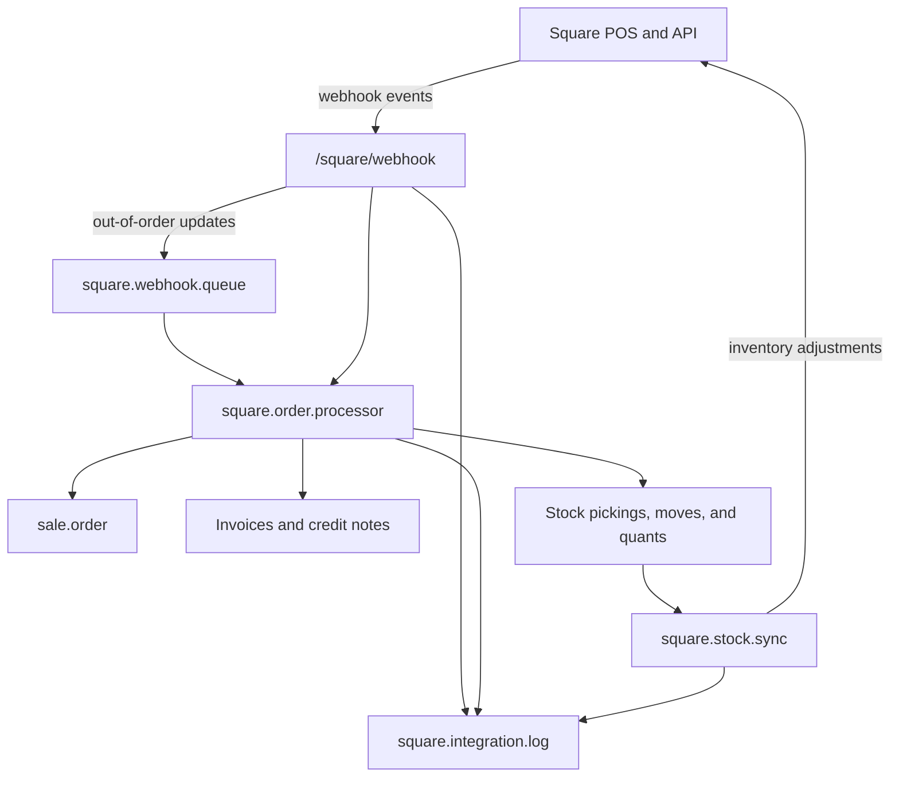

# Square POS Integration

[](https://github.com/davaico/odoo-square/actions/workflows/ci.yml)
[](LICENSE)
[](https://www.odoo.com)

Odoo 18 Community addon for integrating Square POS with Odoo Sales, Accounting, and Inventory.

Checkout, payment collection, and refund initiation take place in Square POS. The addon reflects that activity in Odoo sales orders, accounting records, and stock movements.

For Odoo website checkout, install **Square Online Payments**. You can use either addon on its own or install both in the same database. See the [website setup and coexistence guide](payment_square_online/README.md).

For in-person payments started in Odoo Point of Sale, install **Square Terminal for Point of Sale**. See the [Square Terminal setup guide](pos_square_terminal/README.md).

## Features

- Secure Square webhook endpoint at `/square/webhook` with HMAC-SHA256 validation when a webhook signature key is configured.
- Square order import and updates, including customer and product matching, deliveries from the mapped warehouse, and invoices and Odoo payment records for paid sales.
- Full and partial EUR refunds and supported exchanges, with credit notes or invoices, Odoo payment records, and stock returns where applicable.
- Square location to Odoo warehouse mapping for multi-location inventory workflows.
- Inventory updates from Odoo stock movements and quantity adjustments to mapped Square locations.
- Manual resync wizard for finding and replaying missing Square orders.
- Integration log models and views for monitoring webhook, order, refund, exchange, and stock sync activity.
- Docker Compose development and CI test setup.

## Requirements

- Odoo 18.0 Community and PostgreSQL. The included Compose setup tracks Odoo 18.0 and PostgreSQL 17 on Debian Bookworm.
- Python package: `requests`, included in the official Odoo container
- Square Developer account with an application, access token, location IDs, and webhook signature key
- Docker and Docker Compose for the included local development environment

## Compatibility

This repository follows Odoo addon versioning. The Square POS Integration manifest version is `18.0.1.4.3`, where `18.0` is the Odoo series and `1.4.3` is the addon release version.

The addon manifest declares the following Odoo dependencies:

- `base`
- `web`
- `sale`
- `sales_team`
- `account`
- `stock`
- `sale_stock`
- `payment`

## Quick Start

Clone the Odoo 18 release branch:

```bash
git clone --branch 18.0 https://github.com/davaico/odoo-square.git
cd odoo-square
```

Create a local environment file:

```bash
cp .env.example .env
```

Edit `.env` and set a non-default `DB_PASSWORD`.

Install **Square POS Integration** into the fresh local database, then start Odoo:

```bash
docker compose -p odoo-square-v18 build --pull
docker compose -p odoo-square-v18 run --rm odoo odoo -d odoo_square_v18 -i odoo_square --stop-after-init
docker compose -p odoo-square-v18 up -d
```

Use the database name from `.env` if you changed `DB_NAME`. Open [http://127.0.0.1:8069](http://127.0.0.1:8069) and sign in with the fresh local administrator credentials (`admin` / `admin`). Set `ODOO_HTTP_PORT` in `.env` if that port is already in use.

### Install on an existing Odoo 18 Community server

1. Place the `odoo_square` directory from the `18.0` branch inside one of the directories listed in the server's `addons_path`.
2. Install `requests` in the Python environment that runs Odoo, then restart Odoo.
3. In the target database, activate developer mode and use **Apps > Update Apps List**. Search for **Square POS Integration** and install it. Odoo installs the declared addon dependencies automatically.

## Square Configuration

In the Square Developer Dashboard, create a webhook subscription for the same environment as your Square credentials. Append `/square/webhook` to your public HTTPS Odoo URL as shown below.

```text
https://your-odoo-domain.example/square/webhook
```

Subscribe to these event types.

- `order.created` and `order.updated` for order import and supported updates or cancellations.
- `payment.updated` for detecting exchanges from completed Square payments.
- `refund.created` and `refund.updated` for recording Square refunds as their status changes.

Set up the company's chart of accounts and a bank journal for recording Square receipts and refunds. In Odoo, open **Square > Configuration** and create a configuration with the following details.

- The matching Square environment (`Sandbox` or `Production`), application ID, and access token
- The webhook signature key from the Square Developer Dashboard
- The **Payment Journal** used to record Square receipts and refunds
- A mapping from each Square location ID to its Odoo warehouse
- An optional default Sales Team and optional per-location Sales Teams

Save the configuration and use **Test Connection** to verify the Square credentials. You can use **Synchronize Locations** after connecting to import Square locations, then check the warehouse selected for each mapping. To match catalog products for sales and stock sync, use the Square SKU as the Odoo product's **Internal Reference** and enable inventory tracking for products whose stock you want to synchronize.

For production deployments, run Odoo behind HTTPS and keep `proxy_mode = True` in `config/odoo.conf` when a reverse proxy terminates TLS.

## Development

Start the local stack:

```bash
docker compose -p odoo-square-v18 up -d
```

To refresh the images and apply current operating system package updates, rebuild and recreate the services with their existing volumes.

```bash
docker compose -p odoo-square-v18 build --pull --no-cache
docker compose -p odoo-square-v18 up -d
```

Follow Odoo logs:

```bash
docker compose -p odoo-square-v18 logs -f odoo
```

Restart Odoo after Python changes:

```bash
docker compose -p odoo-square-v18 restart odoo
```

Update the addon after manifest, XML, or model changes:

```bash
docker compose -p odoo-square-v18 stop odoo
docker compose -p odoo-square-v18 run --rm odoo odoo -d odoo_square_v18 -u odoo_square --stop-after-init
docker compose -p odoo-square-v18 up -d
```

For existing PostgreSQL 17 databases, review the [17.12 upgrade notes](https://www.postgresql.org/docs/17/release-17-12.html#RELEASE-17-12-MIGRATION) for index and backup steps that apply to your database.

## Testing

Run the CI test service with its own Compose project, database, and volumes:

```bash
test_project=odoo-square-v18-test-$$
export DB_PASSWORD=ci_odoo_test DB_NAME=odoo_square_v18_test
docker compose -p "$test_project" -f docker-compose.test.yml build --pull
docker compose -p "$test_project" -f docker-compose.test.yml run --rm odoo
docker compose -p "$test_project" -f docker-compose.test.yml down -v
```

Set `ODOO_TEST_TAGS` for a focused run, for example `/odoo_square:TestSquareModuleContracts`.

The suite includes HTTP webhook tests, Square order/refund integration scenarios, stock return behavior, manual resync behavior, and addon contract tests.

## Project Structure

```text
odoo-square/
├── odoo_square/
│   ├── controllers/            # Public webhook endpoint
│   ├── data/                   # Default users and Square products
│   ├── models/                 # Odoo business models and services
│   ├── security/               # ir.model.access.csv
│   ├── static/description/     # Odoo app listing assets
│   ├── tests/                  # Odoo TransactionCase and HttpCase tests
│   └── views/                  # Backend UI views and menus
├── config/                     # Odoo container configuration
├── .github/workflows/          # CI
├── docker-compose.yml          # Local development stack
├── docker-compose.test.yml     # Test stack used by CI
└── README.md
```

## Architecture



## Operational Notes

When deploying Square POS Integration `18.0.1.4.3`, [upgrade the installed module](#development) before resuming stock synchronization. The upgrade adds stock-count metadata used by Square Terminal and preserves pending counts.

When upgrading Square POS Integration to `18.0.1.4.2`, update the installed module to apply the refund schema change. Unverified legacy refunds retain their claimed Square ID and document links for review. Confirmed Square deliveries can use the same ID to record the verified refund. If your installation processed a signed replay on 18.0.1.4.1 and a historical refund was removed, consult a backup taken before that operation for its original links.

- Configure the webhook signature key in Odoo before exposing the endpoint publicly.
- Keep Square access tokens out of Git. Use Odoo configuration records, environment-specific secrets management, or encrypted backups.
- Map every active Square location to the intended Odoo warehouse before enabling production inventory sync.
- Automatic stock counts are queued with the stock change. The **Square POS: Send inventory counts** scheduled action sends committed warehouse quantities every minute and retries failed requests after five minutes. A newer observation replaces an older queued count for the same SKU and location. Square accepts observations up to 24 hours old. After that, or after correcting an ambiguous SKU, use **Synchronize All Products** to send a fresh count.
- Review the integration logs under **Square > Activity** and inspect out-of-order events under **Square > Webhook Queue**.
- To recover orders missing from Odoo, open the configuration and choose **Manual Resync Orders**. Set a date range, choose **Scan Missing Orders**, select the orders to recover, then choose **Validate and Resync**.

## Contributing

Contributions are welcome. Read [CONTRIBUTING.md](CONTRIBUTING.md) before opening an issue or pull request.

## Security

Please do not open public issues for vulnerabilities. See [SECURITY.md](SECURITY.md) for the supported version and private reporting process.

## License

This project is licensed under the GNU Affero General Public License v3.0 or later. See [LICENSE](LICENSE).
