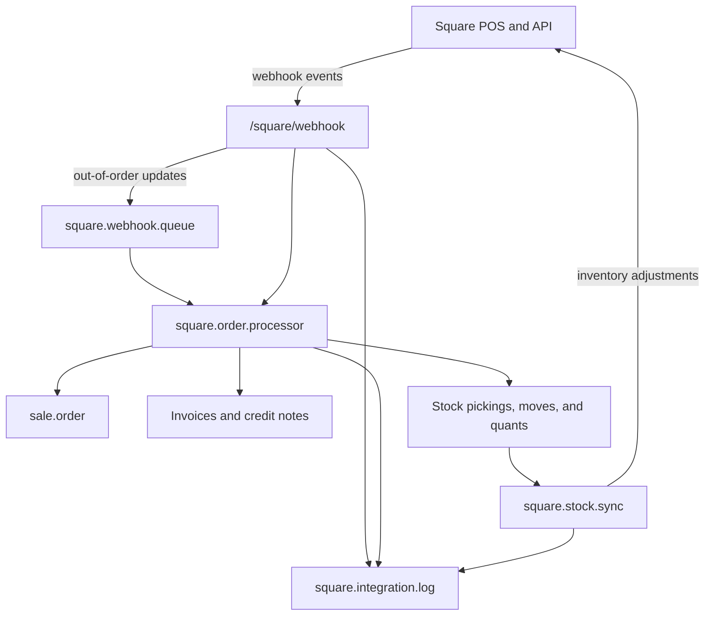

# Square POS Integration

[](https://github.com/davaico/odoo-square/actions/workflows/ci.yml)
[](LICENSE)
[](https://www.odoo.com)

Odoo 19 Community addon for integrating Square POS with Odoo Sales, Accounting, and Inventory.

Checkout, payment collection, and refund initiation happen in Square. The addon processes Square webhooks and records the resulting sales, payments, refunds, exchanges, and stock movements in Odoo.

## Features

- Secure Square webhook endpoint at `/square/webhook` with HMAC-SHA256 validation when a webhook signature key is configured.
- Order ingestion for `order.created` and `order.updated` events, including customer matching and sale order creation.
- Refund and exchange handling with invoices, credit notes, stock returns, and preserved order history.
- Square location to Odoo warehouse mapping for multi-location inventory workflows.
- Inventory synchronization hooks for Odoo stock movements and manual quantity changes.
- Manual resync wizard for finding and replaying missing Square orders.
- Integration log models and views for monitoring webhook, order, refund, exchange, and stock sync activity.
- Docker Compose development and CI test setup.

## Requirements

- A fresh Odoo 19.0 Community database and PostgreSQL. The included Compose setup uses the official Odoo Community image and PostgreSQL 17.
- Python package `requests` in the Odoo environment. The Compose image includes it.
- A Square Developer account with an application, access token, location IDs, and webhook signature key.
- Docker and Docker Compose for the included local setup.

## Compatibility

Use release branch `19.0` for Odoo 19 Community. The manifest version is `19.0.1.4.0`, where `19.0` is the Odoo series and `1.4.0` is the addon release version.

The addon manifest declares the following Odoo dependencies:

- `base`
- `web`
- `sale`
- `sales_team`
- `account`
- `stock`
- `sale_stock`
- `payment`

## Quick Start

Clone the Odoo 19 release branch and create a local environment file.

```bash
git clone --branch 19.0 https://github.com/davaico/odoo-square.git
cd odoo-square
cp .env.example .env
```

Set `DB_PASSWORD` in `.env`. Install the addon into the fresh database, then start Odoo.

```bash
docker compose run --rm odoo odoo --database=odoo_square_v19 --init=odoo_square --stop-after-init
docker compose up -d
```

Open [Odoo on localhost port 8069](http://localhost:8069) and sign in to the fresh database with Odoo's initial `admin` login and password. Change the initial password after signing in. If you changed `DB_NAME` or `ODOO_PORT`, use the corresponding database name and port. The `odoo-square-v19` Compose project has its own database and filestore volumes.

For a standalone Odoo 19 Community setup, put the `odoo_square` folder on the Odoo addons path, restart Odoo, update the Apps list in the fresh database, and install **Square POS Integration**.

## Square Configuration

Set up the company's chart of accounts and enable EUR for the integration. In Odoo, open **Square > Configuration** and create the Square configuration.

- Enter the **Square Application ID** and **Square Access Token**, and select **Sandbox** or **Production** to match the credentials.
- Select the **Payment Journal** that records Square payments and refunds in Odoo.
- Add a **Square Location Mapping** with the Square location ID, location name, and corresponding Odoo warehouse for each location.
- Optionally select a sales team for each mapping and a **Default Sales Team**.
- Save the configuration and use **Test Connection** to verify the Square credentials.

In the Square Developer Dashboard, create a webhook subscription that points to:

```text
https://your-odoo-domain.example/square/webhook
```

Copy the subscription's signature key into **Webhook Signature Key** in the Odoo configuration. Subscribe to these event types.

- `order.created`
- `order.updated`
- `payment.updated`
- `refund.created`
- `refund.updated`

For production deployments, run Odoo behind HTTPS and keep `proxy_mode = True` in `config/odoo.conf` when a reverse proxy terminates TLS.

## Development

Start the local stack.

```bash
docker compose up -d
```

Follow Odoo logs.

```bash
docker compose logs -f odoo
```

Restart Odoo after Python changes.

```bash
docker compose restart odoo
```

Update the addon after manifest, XML, or model changes. Use the database name from `.env` if it differs from the default.

```bash
docker compose stop odoo
docker compose run --rm odoo odoo --database=odoo_square_v19 --update=odoo_square --stop-after-init
docker compose up -d odoo
```

## Testing

Use the test Compose project for a fresh addon installation and test run.

```bash
docker compose -f docker-compose.test.yml down -v
docker compose -f docker-compose.test.yml run --rm -T odoo
docker compose -f docker-compose.test.yml down -v
```

These commands reset only the `odoo-square-v19-test` project. The test run should report zero failures and errors and a nonzero test count. The suite uses real Odoo records and mocked Square API responses. It includes HTTP webhook tests, Square order and refund scenarios, stock returns, manual resync, and addon contracts.

## Project Structure

```text
odoo-square/
├── odoo_square/
│   ├── controllers/            # Public webhook endpoint
│   ├── data/                   # Default users and Square products
│   ├── models/                 # Odoo business models and services
│   ├── security/               # ir.model.access.csv
│   ├── static/description/     # Odoo app listing assets
│   ├── tests/                  # Odoo TransactionCase and HttpCase tests
│   └── views/                  # Backend UI views and menus
├── config/                     # Odoo container configuration
├── .github/workflows/          # CI
├── docker-compose.yml          # Local development stack
├── docker-compose.test.yml     # Test stack used by CI
└── README.md
```

## Architecture



## Operational Notes

- Configure the webhook signature key in Odoo before exposing the endpoint publicly.
- Keep Square access tokens out of Git. Use Odoo configuration records, environment-specific secrets management, or encrypted backups.
- Map every active Square location to the intended Odoo warehouse before enabling production inventory sync.
- Review **Square Integration Logs** after installation and after every Square credential or webhook change.
- Use the manual resync wizard for missed or delayed Square events instead of replaying raw webhook requests manually.

## Contributing

Contributions are welcome. Read [CONTRIBUTING.md](CONTRIBUTING.md) before opening an issue or pull request.

## Security

Please do not open public issues for vulnerabilities. See [SECURITY.md](SECURITY.md) for the supported version and private reporting process.

## License

This project is licensed under the GNU Affero General Public License v3.0 or later. See [LICENSE](LICENSE).
