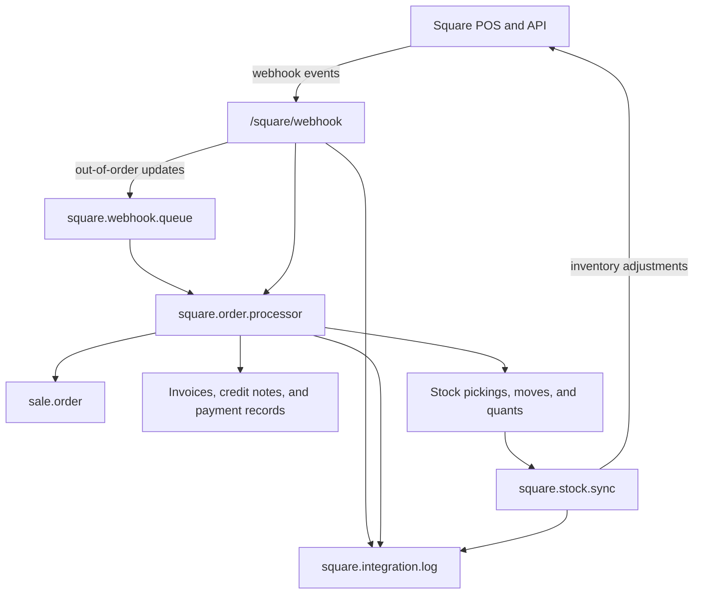

# Square POS Integration

[](https://github.com/davaico/odoo-square/actions/workflows/ci.yml)
[](LICENSE)
[](https://www.odoo.com)

Odoo 19 Community addon for integrating Square POS with Odoo Sales, Accounting, and Inventory.

Checkout, payment collection, and refund initiation happen in Square. The addon processes Square webhooks and records the resulting sales, payments, refunds, exchanges, and stock movements in Odoo.

For Odoo website checkout, install **Square Online Payments**. You can install either addon on its own or run both in the same database. See the [website setup guide](payment_square_online/README.md) and [combined setup](payment_square_online/README.md#run-alongside-square-pos).

## Features

- Secure Square webhook endpoint at `/square/webhook` with HMAC-SHA256 validation when a webhook signature key is configured.
- Square order import and supported updates and cancellations. Completed sales post invoices, record payments collected by Square, and deduct tracked stock from the mapped warehouse.
- Full and partial EUR refunds with credit notes, outbound payment records, and stock returns where applicable. Supported exchanges process returned and replacement items and record any price difference.
- Square location to Odoo warehouse mapping for multi-location inventory workflows.
- Outbound updates of on-hand stock counts for matching SKUs after supported Odoo stock movements and applied inventory adjustments in mapped warehouses.
- Manual resync wizard for finding and replaying missing Square orders.
- Integration log models and views for monitoring webhook, order, refund, exchange, and stock sync activity.
- Docker Compose development and CI test setup.

## Requirements

- A fresh Odoo 19.0 Community database and PostgreSQL. The included Compose setup builds from the official Odoo Community image with Ubuntu package updates and uses PostgreSQL 17.
- Python package `requests` in the Odoo environment. The Compose image includes it.
- A Square Developer account with an application, access token, location IDs, and webhook signature key.
- Docker and Docker Compose for the included local setup.

## Compatibility

Use release branch `19.0` for Odoo 19 Community. The manifest version is `19.0.1.4.2`, where `19.0` is the Odoo series and `1.4.2` is the addon release version.

The addon manifest declares the following Odoo dependencies:

- `base`
- `web`
- `sale`
- `sales_team`
- `account`
- `stock`
- `sale_stock`
- `payment`

## Quick Start

Clone the Odoo 19 release branch and create a local environment file.

```bash
git clone --branch 19.0 https://github.com/davaico/odoo-square.git
cd odoo-square
cp .env.example .env
```

Set `DB_PASSWORD` in `.env`. Install the addon into the fresh database, then start Odoo.

```bash
docker compose build --pull
docker compose run --rm odoo odoo --database=odoo_square_v19 --init=odoo_square --stop-after-init
docker compose up -d
```

Open [Odoo on localhost port 8069](http://localhost:8069) and sign in to the fresh database with Odoo's initial `admin` login and password. Change the initial password after signing in. If you changed `DB_NAME` or `ODOO_PORT`, use the corresponding database name and port. The `odoo-square-v19` Compose project has its own database and filestore volumes.

For a standalone Odoo 19 Community setup, put the `odoo_square` folder on the Odoo addons path, restart Odoo, update the Apps list in the fresh database, and install **Square POS Integration**.

## Square Configuration

Set up the company's chart of accounts and configure EUR for Square transactions. In Odoo, open **Square > Configuration** and create the Square configuration.

- Enter the **Square Application ID** and **Square Access Token**, and select **Sandbox** or **Production** to match the credentials.
- Select the company's **Payment Journal** for incoming and outgoing Square payment records. A bank journal can record both sales and refunds.
- Add a **Square Location Mapping** with the Square location ID, location name, and corresponding Odoo warehouse for each location.
- Optionally select a sales team for each mapping and a **Default Sales Team**.
- Save the configuration and use **Test Connection** to verify the Square credentials.

For products that should affect stock, enable **Track Inventory** in Odoo and match the Odoo **Internal Reference** to the Square SKU.

In the Square Developer Dashboard, create a webhook subscription that points to:

```text
https://your-odoo-domain.example/square/webhook
```

Copy the subscription's signature key into **Webhook Signature Key** in the Odoo configuration. Subscribe to these event types.

- `order.created` and `order.updated` for order import and supported status and line changes.
- `payment.updated` for completed payments tied to supported exchanges.
- `refund.created` and `refund.updated` for refund creation and status changes.

Use a publicly reachable HTTPS URL for the webhook. When a reverse proxy terminates TLS, keep `proxy_mode = True` in `config/odoo.conf` and forward the public hostname so Odoo can verify the signature against the subscription URL.

## Development

Start the local stack.

```bash
docker compose up -d
```

To refresh the Odoo 19.0 and PostgreSQL 17 images and apply current Ubuntu package updates, rebuild the images and recreate the services with the existing volumes.

```bash
docker compose build --pull --no-cache
docker compose up -d
```

When updating to PostgreSQL 17.12, review its migration notes for affected indexes and incremental backups. [PostgreSQL 17.12 release notes](https://www.postgresql.org/docs/17/release-17-12.html)

Follow Odoo logs.

```bash
docker compose logs -f odoo
```

Restart Odoo after Python changes.

```bash
docker compose restart odoo
```

Update the addon after manifest, XML, or model changes. Use the database name from `.env` if it differs from the default.

```bash
docker compose stop odoo
docker compose run --rm odoo odoo --database=odoo_square_v19 --update=odoo_square --stop-after-init
docker compose up -d odoo
```

## Testing

Use the test Compose project for a fresh addon installation and test run.

```bash
docker compose -f docker-compose.test.yml down -v
docker compose -f docker-compose.test.yml run --rm -T odoo
docker compose -f docker-compose.test.yml down -v
```

These commands reset only the `odoo-square-v19-test` project. The test run should report zero failures and errors and a nonzero test count. The suite uses real Odoo records and mocked Square API responses. It covers order import and updates, payments, refunds, exchanges, stock movements and counts, manual order resync, webhook validation, and addon contracts.

## Project Structure

```text
odoo-square/
├── odoo_square/
│   ├── controllers/            # Public webhook endpoint
│   ├── data/                   # Default users and Square products
│   ├── models/                 # Odoo business models and services
│   ├── security/               # ir.model.access.csv
│   ├── static/description/     # Odoo app listing assets
│   ├── tests/                  # Odoo TransactionCase and HttpCase tests
│   └── views/                  # Backend UI views and menus
├── config/                     # Odoo container configuration
├── .github/workflows/          # CI
├── docker-compose.yml          # Local development stack
├── docker-compose.test.yml     # Test stack used by CI
└── README.md
```

## Architecture



## Operational Notes

When upgrading Square POS Integration to `19.0.1.4.2`, update the installed module to apply the refund schema change. Unverified legacy refunds retain their claimed Square ID and document links for review. Confirmed Square deliveries can use the same ID to record the verified refund. If your installation already ran the 19.0.1.4.1 migration and a historical refund was removed, consult a backup taken before that operation for its original links.

- Configure the webhook signature key in Odoo before exposing the endpoint publicly.
- Keep Square access tokens out of Git. Use Odoo configuration records, environment-specific secrets management, or encrypted backups.
- Map every active Square location to the intended Odoo warehouse before enabling production inventory sync.
- Automatic stock counts are queued with the stock change. The **Square POS: Send inventory counts** scheduled action sends committed warehouse quantities every minute and retries failed requests after five minutes. A newer observation replaces an older queued count for the same SKU and location. Square accepts observations up to 24 hours old. After that, or after correcting an ambiguous SKU, use **Synchronize All Products** to send a fresh count.
- Review **Square Integration Logs** after installation and after every Square credential or webhook change.
- To recover missing Square orders, open **Manual Resync Orders** from **Square > Configuration**, scan the relevant dates, and select the orders to import.

## Contributing

Contributions are welcome. Read [CONTRIBUTING.md](CONTRIBUTING.md) before opening an issue or pull request.

## Security

Please do not open public issues for vulnerabilities. See [SECURITY.md](SECURITY.md) for the supported version and private reporting process.

## License

This project is licensed under the GNU Affero General Public License v3.0 or later. See [LICENSE](LICENSE).
