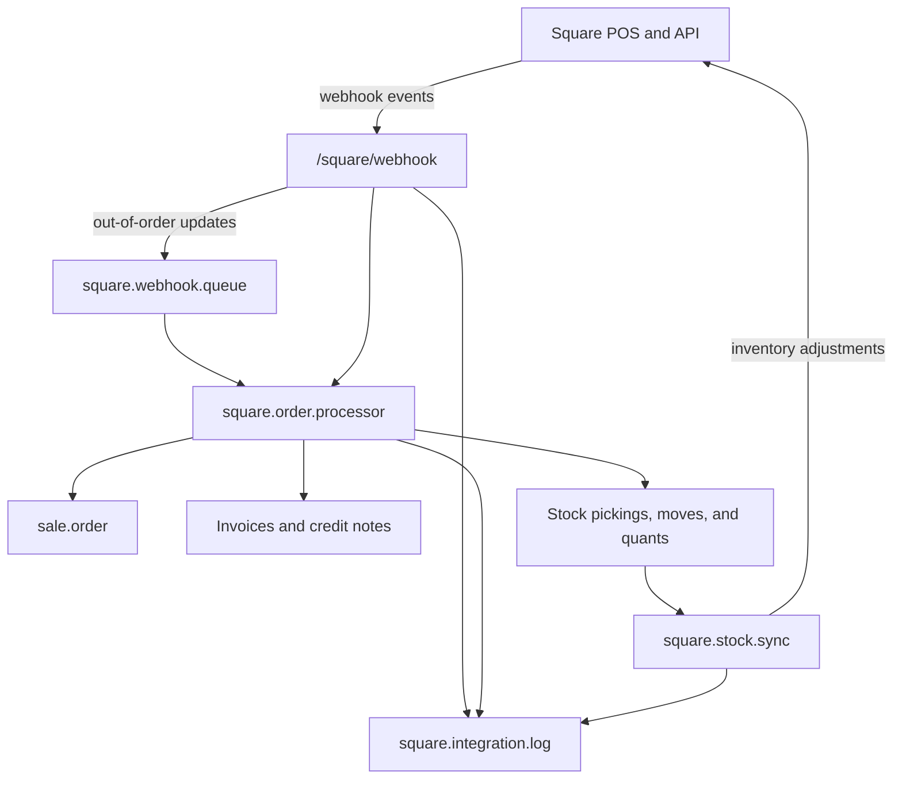

# Square integrations for Odoo 18

[](https://github.com/davaico/odoo-square/actions/workflows/ci.yml)
[](LICENSE)
[](https://www.odoo.com)

Choose the Odoo 18 Community addon for the register or storefront where the sale starts. You can install each independently or use all three in one database.

| Where the sale starts | Addon | What it does |
| --- | --- | --- |
| Square POS | [Square POS Integration](#square-configuration) | Imports sales, EUR refunds and supported exchanges into Odoo Sales, Accounting and Inventory. Publishes warehouse stock to mapped Square locations. |
| Odoo Point of Sale | [Square Terminal for Point of Sale](pos_square_terminal/README.md) | Sends the cashier’s card share to a paired terminal. The sale and itemized receipt stay in Odoo POS. |
| Odoo website | [Square Online Payments](payment_square_online/README.md) | Collects website payments through Square and lets accounting staff refund the original payment. |

## Importer requirements

- Odoo 18 Community and PostgreSQL. The included Compose setup uses PostgreSQL 17.
- Python package: `requests`, included in the official Odoo container
- Square Developer account with an application, access token, location IDs, and webhook signature key
- Docker and Docker Compose for the included local development environment

## Quick Start

Clone the Odoo 18 release branch and create a local environment file.

```bash
git clone --branch 18.0 https://github.com/davaico/odoo-square.git
cd odoo-square
cp .env.example .env
```

Edit `.env` and set a non-default `DB_PASSWORD`.

Install **Square POS Integration** into the fresh local database, then start Odoo:

```bash
docker compose -p odoo-square-v18 build --pull
docker compose -p odoo-square-v18 run --rm odoo odoo -d odoo_square_v18 -i odoo_square --stop-after-init
docker compose -p odoo-square-v18 up -d
```

Use the database name from `.env` if you changed `DB_NAME`. Open [http://127.0.0.1:8069](http://127.0.0.1:8069) and sign in with the fresh local administrator credentials (`admin` / `admin`). Set `ODOO_HTTP_PORT` in `.env` if that port is already in use.

### Install on an existing Odoo 18 Community server

1. Place the `odoo_square` directory from the `18.0` branch inside one of the directories listed in the server's `addons_path`.
2. Install `requests` in the Python environment that runs Odoo, then restart Odoo.
3. In the target database, activate developer mode and use **Apps > Update Apps List**. Search for **Square POS Integration** and install it. Odoo installs the declared addon dependencies automatically.

## Square Configuration

In the Square Developer Dashboard, create a webhook subscription for the same environment as your Square credentials. Append `/square/webhook` to your public HTTPS Odoo URL as shown below.

```text
https://your-odoo-domain.example/square/webhook
```

Subscribe to these event types.

- `order.created` and `order.updated` for order import and supported updates or cancellations.
- `payment.updated` for detecting exchanges from completed Square payments.
- `refund.created` and `refund.updated` for recording Square refunds as their status changes.

Set up the company's chart of accounts and a bank journal for recording Square receipts and refunds. In Odoo, open **Square > Configuration** and create a configuration with the following details.

- The matching Square environment (`Sandbox` or `Production`), application ID, and access token
- The webhook signature key from the Square Developer Dashboard
- The **Payment Journal** used to record Square receipts and refunds
- A mapping from each Square location ID to its Odoo warehouse
- An optional default Sales Team and optional per-location Sales Teams

Save the configuration and use **Test Connection** to verify the Square credentials. You can use **Synchronize Locations** after connecting to import Square locations, then check the warehouse selected for each mapping. To match catalog products for sales and stock sync, use the Square SKU as the Odoo product's **Internal Reference** and enable inventory tracking for products whose stock you want to synchronize.

For production deployments, run Odoo behind HTTPS and keep `proxy_mode = True` in `config/odoo.conf` when a reverse proxy terminates TLS.

## Development

To refresh the images and apply current operating system package updates, rebuild and recreate the services with their existing volumes.

```bash
docker compose -p odoo-square-v18 build --pull --no-cache
docker compose -p odoo-square-v18 up -d
```

Follow Odoo logs:

```bash
docker compose -p odoo-square-v18 logs -f odoo
```

Restart Odoo after Python changes:

```bash
docker compose -p odoo-square-v18 restart odoo
```

Update the addon after manifest, XML, or model changes:

```bash
docker compose -p odoo-square-v18 stop odoo
docker compose -p odoo-square-v18 run --rm odoo odoo -d odoo_square_v18 -u odoo_square --stop-after-init
docker compose -p odoo-square-v18 up -d
```

For existing PostgreSQL 17 databases, review the [17.12 upgrade notes](https://www.postgresql.org/docs/17/release-17-12.html#RELEASE-17-12-MIGRATION) for index and backup steps that apply to your database.

## Testing

The test service runs the importer by default. To exercise another addon combination, export the matching `modules` and `tags` values from the [CI matrix](.github/workflows/ci.yml) as `ODOO_INIT_MODULES` and `ODOO_TEST_TAGS`. Use a fresh Compose project for each selection.

```bash
test_project=odoo-square-v18-test-$$
export DB_PASSWORD=ci_odoo_test DB_NAME=odoo_square_v18_test
export ODOO_TEST_DOCKERFILE=config/Dockerfile.test
docker compose -p "$test_project" -f docker-compose.test.yml build --pull
docker compose -p "$test_project" -f docker-compose.test.yml run --rm odoo
docker compose -p "$test_project" -f docker-compose.test.yml down -v
```

For a focused importer test, set `ODOO_TEST_TAGS=/odoo_square:TestSquareModuleContracts`. Check the test summary for a nonzero number of tests and no failures, errors or skipped addon tests. The concurrency suites use independent database connections and commit records. Run their dedicated Odoo shell commands from the [CI workflow](.github/workflows/ci.yml) in disposable databases.

## Importer data flow



## Operational Notes

When deploying Square POS Integration `18.0.1.4.3`, [upgrade the installed module](#development) before resuming stock synchronization. The upgrade adds stock-count metadata used by Square Terminal and preserves pending counts.

When upgrading Square POS Integration to `18.0.1.4.2`, update the installed module to apply the refund schema change. Unverified legacy refunds retain their claimed Square ID and document links for review. Confirmed Square deliveries can use the same ID to record the verified refund. If your installation processed a signed replay on 18.0.1.4.1 and a historical refund was removed, consult a backup taken before that operation for its original links.

- Configure the webhook signature key in Odoo before exposing the endpoint publicly.
- Keep Square access tokens out of Git. Use Odoo configuration records, environment-specific secrets management, or encrypted backups.
- Map every active Square location to the intended Odoo warehouse before enabling production inventory sync.
- **Square POS: Send inventory counts** publishes the latest queued warehouse quantity for each mapped product and location. Odoo automatically takes a fresh measurement when a queued count is more than 24 hours old. If duplicate Square catalog SKUs paused a count, make the SKU unique and choose **Synchronize All Products** to send a fresh count.
- Review the integration logs under **Square > Activity** and inspect out-of-order events under **Square > Webhook Queue**.
- To recover orders missing from Odoo, open the configuration and choose **Manual Resync Orders**. Set a date range and choose **Scan Missing Orders**. If references await ownership verification, choose **Scan Again** once Square access recovers, or recover the identified sales now and start a new scan later. Select the orders to recover and choose **Validate and Resync**.

## Contributing

Contributions are welcome. Read [CONTRIBUTING.md](CONTRIBUTING.md) before opening an issue or pull request.

## Security

Please do not open public issues for vulnerabilities. See [SECURITY.md](SECURITY.md) for the supported version and private reporting process.

## License

This project is licensed under the GNU Affero General Public License v3.0 or later. See [LICENSE](LICENSE).
